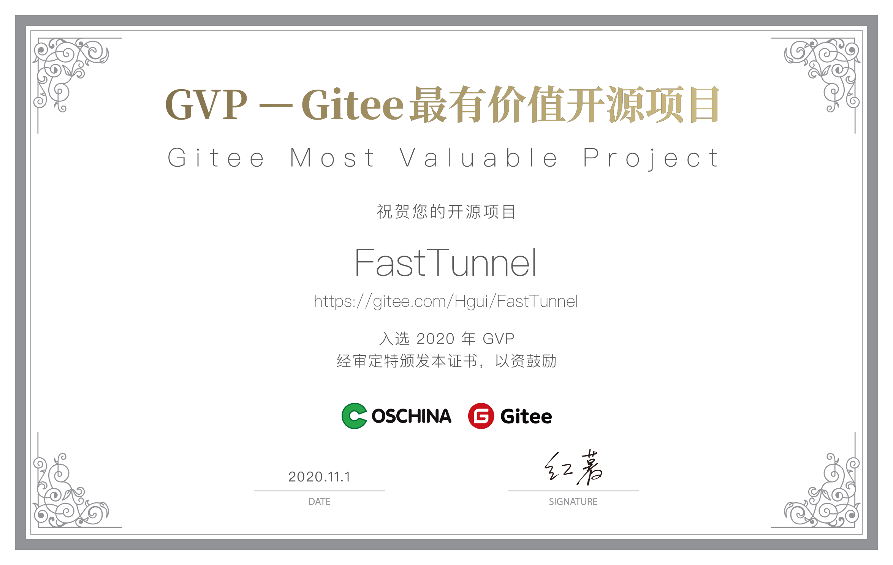

  

## FastTunnel

[README](README.md) | [中文介绍](README_zh.md)  

## What is FastTunnel？
- FastTunnel is a high-performance cross-platform intranet penetration tool. With it, you can expose intranet services to the public network for yourself or anyone to access.
- Unlike other penetration tools, the FastTunnel project is committed to creating an easy-to-extensible and easy-to-maintain intranet penetration framework.
- You can build your own penetration application by referencing the nuget package of `FastTunnel.Core`, and target the business extension functions you need.

## Docs
[https://docs.suidao.io](https://docs.suidao.io)

***If you use the intranet to penetrate and expose port 3389, you must pay attention to the fact that the password of the computer must be set to be more complicated to avoid being hacked by hackers to crack the computer login password and cause losses.***

***If you use the intranet to penetrate and expose port 3389, you must pay attention to the fact that the password of the computer must be set to be more complicated to avoid being hacked by hackers to crack the computer login password and cause losses.***

***If you use the intranet to penetrate and expose port 3389, you must pay attention to the fact that the password of the computer must be set to be more complicated to avoid being hacked by hackers to crack the computer login password and cause losses.***
## Enjoy Now
Official website : https://suidao.io  

## Repositories

[GitHub](https://github.com/FastTunnel/FastTunnel)  
[Gitee](https://gitee.com/Hgui/FastTunnel)

**If helpful, click on ⭐Star to support this project, please submit an issue if you have needs and bugs, and welcome coder to PR**

## GVP Projrct

***

## What can FastTunnel do?
- [x] Reach intranet machines (Windows / Linux / macOS) from anywhere
- [x] Expose intranet web services via subdomains or custom domains (WeChat development, public previews)
- [x] TCP / UDP port forwarding for any intranet service (MySQL, Redis, RDP, ...)
- [x] Bind multiple domains to one client
- [x] Custom domain validation: rejects malformed hosts, platform-subdomain squatting and hijacking another client's mapping
- [x] Server-side custom domain blacklist (`FastTunnel:WebDomainBlacklist`)
- [x] Single-port multiplexing (MUX): all forwards share one long-lived connection instead of reconnecting per request
- [x] TLS for the client channel (on by default) with SHA-256 certificate fingerprint pinning
- [x] Control-channel heartbeat / stale-connection detection; structured protocol stays compatible with older clients
- [x] MUX data plane over TCP or WebSocket (traverses HTTP(S)-only firewalls)
- [x] Dual-stack IPv4 / IPv6 for listeners, port forwards and intranet targets
- [x] Client authentication (Token); the matched credential is bound to the session for auditing / bans
- [x] Visitor IP allowlist (`FastTunnel:WebAllowAccessIps`, IP or CIDR)
- [x] Real client IP recovery: forwarding headers trusted only from `FastTunnel:TrustedProxyIps`
- [x] Abuse takedown: banned hosts/tokens get `451`, mappings are revoked, sessions disconnected, audit written
- [x] Disposition API (`api/Abuse/*`): ban / unban / human review / anonymous report; automation cannot permanently ban
- [x] One token per account (`FastTunnel:Clients`): stable subject, domain authorization, single-session enforcement, account-level bans
- [x] Ops endpoints: `/healthz`, `/metrics` (Prometheus text), `api/Ops/Traffic` per-proxy JSON
- [x] Per-proxy traffic accounting and token-bucket rate limiting (`FastTunnel:Bandwidth`), all four data paths covered
- [x] Multi-format config files: the server loads `appsettings.json` / `appsettings.ini`
      under `config/`, the client the same variants in its app directory; later files override
      earlier ones, all hot-reloadable (sample: `FastTunnel.Server/config/appsettings.sample.ini`;
      INI has no native arrays — use indexed sections for lists)
- [ ] Content inspection (out-of-band review, active crawling): requires user-agreement consent first
- [ ] P2P / STCP / XTCP
- [ ] Dashboard / Admin UI (metrics via `/metrics`, health via `/healthz` are already available)

> Two different "whitelists": the "domain name whitelist" claimed by older docs was never
> implemented — `WebAllowAccessIps` had no reader and was removed in v3.3.0. It is now
> **wired up for real** as a visitor IP allowlist. `WebDomainBlacklist` instead refuses
> registration of certain custom domains.
>
> When running behind a reverse proxy, always set `TrustedProxyIps` to your own proxy's
> source IP / CIDR. Without it, forwarding headers are ignored and the TCP peer IP is used;
> setting `0.0.0.0/0` would let visitors forge their own IP.

> See [FastTunnel.Core/README.md](FastTunnel.Core/README.md) for one-token-per-account
> (`FastTunnel:Clients`), rate limiting (`FastTunnel:Bandwidth`) and `/healthz`, `/metrics`.
 
## Contributors

 
## Join QQ Group

  
  

## License
Apache License 2.0
