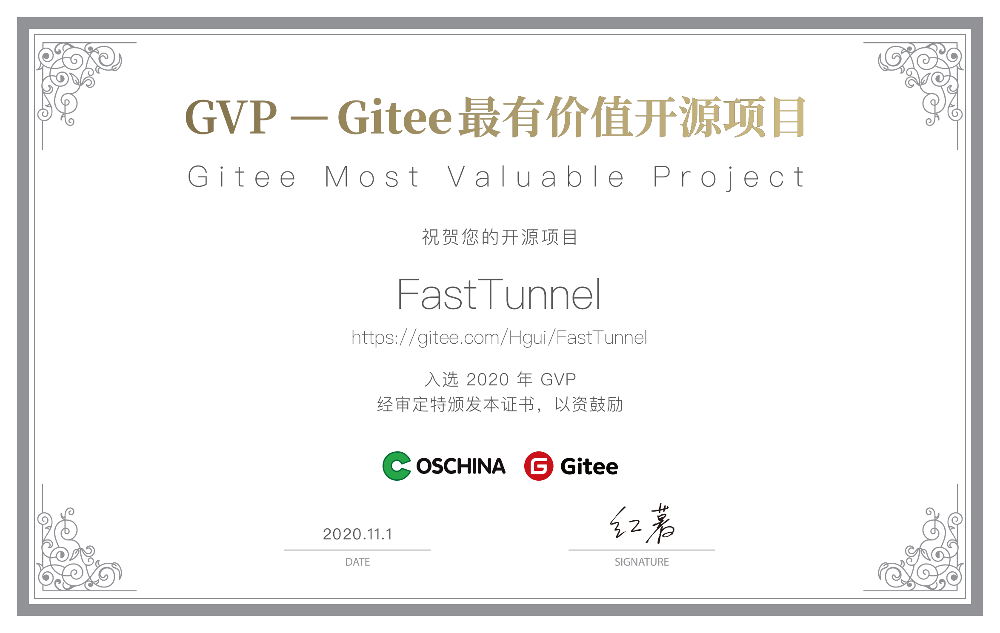

## FastTunnel-内网穿透

[README](README.md) | [中文文档](README_zh.md)

***

## FastTunnel
高性能跨平台内网穿透工具，使用它可以实现将内网服务暴露到公网供自己或任何人访问。
- 与其他穿透工具不同的是，FastTunnel项目致力于打造一个易于扩展、易于维护的内网穿透框架。
- 你可以通过引用`FastTunnel.Core`的nuget包构建出自己的穿透应用，并针自己所需的业务扩展功能。

## 文档
[https://docs.suidao.io](https://docs.suidao.io)

**使用内网穿透暴露3389端口的，一定要注意，电脑的密码一定要设置复杂一点，避免被黑客破解计算机登录密码，造成损失。**   
**使用内网穿透暴露3389端口的，一定要注意，电脑的密码一定要设置复杂一点，避免被黑客破解计算机登录密码，造成损失。**   
**使用内网穿透暴露3389端口的，一定要注意，电脑的密码一定要设置复杂一点，避免被黑客破解计算机登录密码，造成损失。**   
 
## 立即体验内网穿透
官网：https://suidao.io  

## 开源仓库地址
[GitHub](https://github.com/FastTunnel/FastTunnel)  
[Gitee](https://gitee.com/Hgui/FastTunnel)

**有帮助的朋友点下右上角项目的⭐Star支持一下本项目，有需求和bug请提交issue，同时欢迎各位coder进行PR**

## GVP最有价值开源项目

## FastTunnel有哪些特性
- [x] 在任何地方远程内网计算机（Windows / Linux / macOS）
- [x] 通过子域名或自定义域名访问内网 Web 服务（常用于微信开发、对外预览）
- [x] 端口转发 / 端口映射，访问内网任意 TCP / UDP 服务（MySQL、Redis、RDP 等）
- [x] 一个客户端可绑定多个域名访问内网服务
- [x] 自定义域名校验：拒绝非法域名、平台子域抢注和覆盖他人映射
- [x] 服务端自定义域名黑名单（`FastTunnel:WebDomainBlacklist`）
- [x] 单端口多路复用（MUX）：转发复用一条长连接，不再逐条回连
- [x] 客户端通道 TLS 加密（默认开启），支持证书 SHA-256 指纹校验
- [x] 控制通道心跳与假死检测；结构化控制协议兼容旧版客户端
- [x] MUX 数据面支持 TCP / WebSocket 承载，可穿过只放行 HTTP(S) 的防火墙
- [x] IPv4 / IPv6 双栈：服务监听、端口转发、内网目标地址
- [x] 客户端身份校验（Token）；命中的凭据绑定到会话，便于审计与封禁定位主体
- [x] 访问来源 IP 白名单（`FastTunnel:WebAllowAccessIps`，支持 IP / CIDR）
- [x] 真实访客 IP 还原：仅可信代理（`FastTunnel:TrustedProxyIps`）的转发头才被采信
- [x] 违规熔断：命中黑名单立即返回 451、撤销映射、断开会话并保存审计记录
- [x] 处置接口（`api/Abuse/*`）：封禁 / 解封 / 人工复核 / 匿名举报；自动系统不能直接永封
- [x] 一户一 token（`FastTunnel:Clients`）：独立主体、域名授权、单会话强制；按 account 熔断不误伤他人
- [x] 运维最小集：`/healthz`、`/metrics`（Prometheus 文本）、`api/Ops/Traffic` 按代理流量明细
- [x] 按代理带宽统计与令牌桶限速（`FastTunnel:Bandwidth`），覆盖四条数据面
- [x] 多格式配置文件：服务端支持 `config/` 下的 `appsettings.json` / `appsettings.ini`，
      客户端支持程序目录下的同名变体；后加载覆盖先加载，全部支持热重载（示例见
      `FastTunnel.Server/config/appsettings.sample.ini`；INI 无原生数组，列表用节名下标）
- [ ] 内容检测（旁路送审、主动巡检）：需先完成用户协议授权，尚未实施
- [ ] P2P 穿透（STCP / XTCP）
- [ ] Dashboard / Admin UI（指标已有 `/metrics`、健康检查已有 `/healthz`）

> 两个「白名单」别混淆：旧文档打勾的「域名白名单限制」从未实现，那个
> `WebAllowAccessIps` 没有任何读取点，v3.3.0 曾删除；**现已重新接线**，成为真正生效的
> 访问来源 IP 白名单。`WebDomainBlacklist` 则是拒绝登记某些自定义域名，作用完全不同。
>
> 使用反向代理时务必同步配置 `TrustedProxyIps`，只填自己的代理回源 IP / CIDR：不配则
> 转发头一律不采信（按 TCP 对端 IP 判定），配成 `0.0.0.0/0` 等于把白名单交给访客自己填。

> 一户一 token（`FastTunnel:Clients`）、带宽限速（`FastTunnel:Bandwidth`）与
> `/healthz`、`/metrics` 的配置说明见 [FastTunnel.Core/README_zh.md](FastTunnel.Core/README_zh.md)。

## 感谢以下贡献者
  

## QQ群交流群
加群交流FastTunnel相关的使用问题、bug、需求等

  
  

## License
Apache License 2.0

## 特别声明

本项目已加入 [dotNET China](https://gitee.com/dotnetchina)  组织。 

